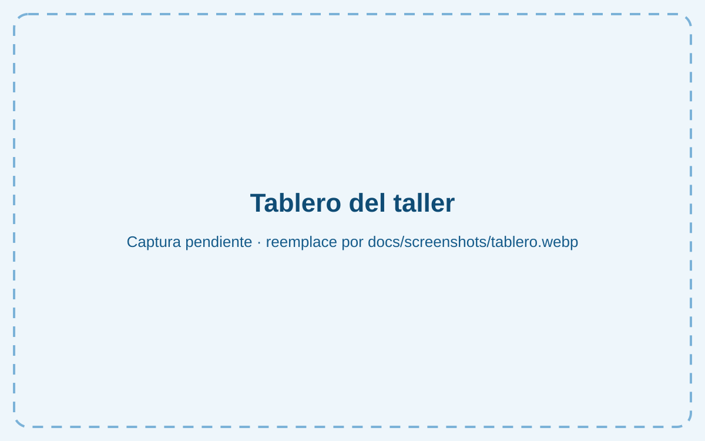
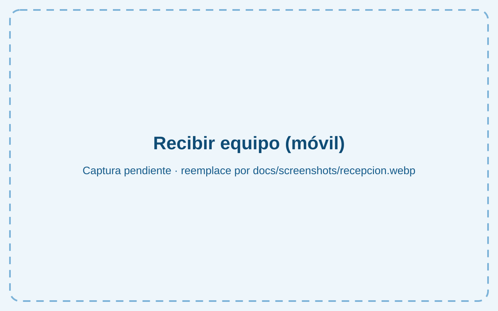
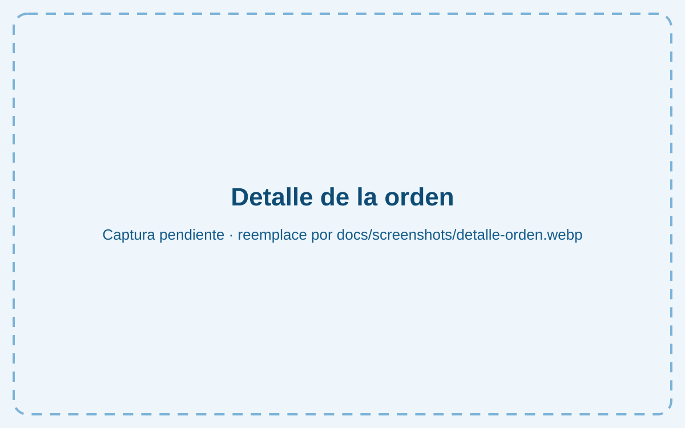
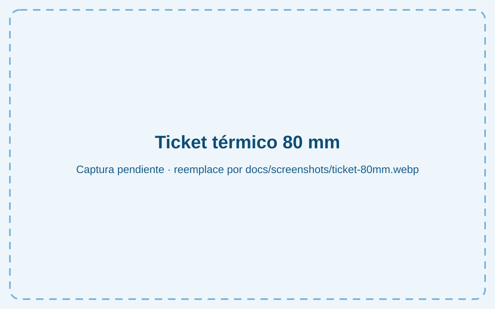
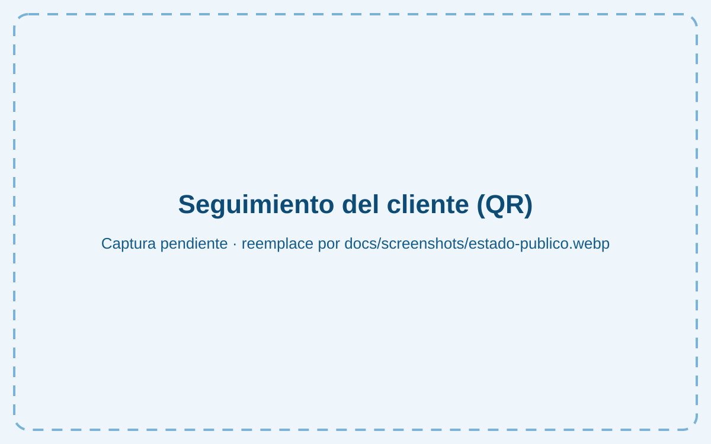
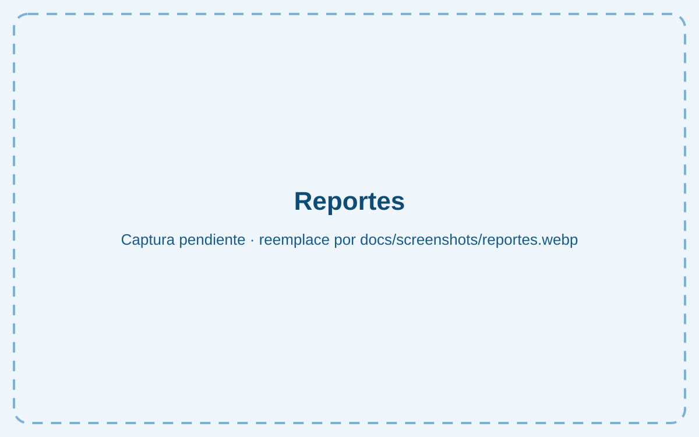

# TallerTrack

[](https://github.com/yanniAlejandro/tallertrack/actions/workflows/ci.yml)

**Sistema de órdenes de servicio para talleres de reparación de celulares.**
Demo construida para **TecnoFix, reparación de celulares (Cerro, La Habana)**: recepción
del equipo con ticket y QR, seguimiento del estado por el cliente, avisos por WhatsApp,
inventario de piezas, garantía y reportes en USD y CUP.

🔗 **Demo:** https://tallertrack.vercel.app _(se activa al desplegar; ver [guía](docs/despliegue.md))_
🔑 **Acceso demo:** `admin@demo.cu` / `demo1234`

---

## El problema de negocio

En un taller típico de La Habana, las órdenes se apuntan en una libreta o en un grupo
de WhatsApp. Eso provoca problemas que cuestan dinero y clientes:

- **«¿Ya está mi teléfono?»**: el dueño contesta las mismas preguntas todo el día.
- **Reclamaciones** por rayones o accesorios porque no quedó constancia de cómo llegó el equipo.
- **Piezas que «desaparecen»**: no se sabe cuántas pantallas quedan ni en qué equipo se usaron.
- **Garantías discutidas**: no hay forma rápida de saber cuándo y quién reparó un IMEI.
- **Precios confusos** cuando la tasa del USD cambia cada semana.
- **No se sabe qué deja dinero**: qué piezas tienen margen o qué técnico tiene más retornos.

TallerTrack lo resuelve con una app web ligera, que funciona en el móvil del técnico
con datos lentos y se instala como app.

## Funcionalidades

|                             |                                                                                                                                                                                                          |
| --------------------------- | -------------------------------------------------------------------------------------------------------------------------------------------------------------------------------------------------------- |
| 🧾 **Recepción del equipo** | Cliente nuevo o existente, IMEI/serie, falla, estado físico, accesorios, fotos, PIN/contraseña/**patrón cifrado**, presupuesto en USD con su equivalente en CUP, técnico y fecha prometida.              |
| 🖨️ **Ticket PDF**           | Formato **80 mm** (impresora térmica) y **A4** (copia cliente + copia taller) con **QR** al seguimiento.                                                                                                 |
| 🔄 **Flujo de estados**     | Recibido → Diagnóstico → Esperando aprobación → En reparación ⇄ Esperando pieza → Listo → Entregado (o Cancelado / No reparable). Historial con **notas internas** y **notas visibles para el cliente**. |
| 💬 **Avisar al cliente**    | Botón de WhatsApp (`wa.me`) con el mensaje pre-llenado según el estado y el total en USD y CUP.                                                                                                          |
| 📱 **Seguimiento público**  | `/estado/TF-2611-7K4Q`: el cliente ve el progreso sin iniciar sesión (sin datos sensibles).                                                                                                              |
| 📦 **Inventario**           | Pantallas, baterías, puertos… con **descuento automático** al usarlas en una orden, alertas de stock bajo e historial de movimientos.                                                                    |
| 🛡️ **Garantía**             | Días configurables, **búsqueda por IMEI** y **reapertura** de la orden sin cobrar mano de obra.                                                                                                          |
| 📊 **Reportes**             | Órdenes por estado, ingresos por mes (USD y CUP), ganancia por pieza y rendimiento por técnico (incluye retornos en garantía).                                                                           |
| 💱 **Multimoneda**          | Precio base en USD; el admin actualiza la tasa CUP (se guarda con fecha y autor) y cada orden **congela** la tasa del día.                                                                               |
| 📲 **PWA**                  | Instalable, con caché de estáticos y página sin conexión.                                                                                                                                                |
| 🧪 **Modo demo**            | Seed con 4 técnicos, 50 órdenes y 30 piezas reales; credenciales en el login y botón **«Restablecer demo»**.                                                                                             |

## Capturas

| Tablero                                     | Recibir equipo (móvil)                                 | Detalle de la orden                            |
| ------------------------------------------- | ------------------------------------------------------ | ---------------------------------------------- |
|     |            |  |
| **Ticket 80 mm**                            | **Seguimiento del cliente**                            | **Reportes**                                   |
|  |  |      |

> Las imágenes son provisionales: sustitúyalas por capturas reales en WebP dentro de `docs/screenshots/`.

## Stack

- **Next.js 16** (App Router, Server Components, Server Actions) + **React 19** + **TypeScript estricto**
- **Tailwind CSS 4** (color principal `#0f4c75`, sin fuentes web)
- **Supabase**: Postgres con **RLS**, Auth, Storage y funciones SQL
- **Zod** (validación compartida), **@react-pdf/renderer** + **qrcode** (tickets)
- **Vitest** + **PGlite** (Postgres en WASM para probar el SQL), **ESLint**, **Prettier**
- **GitHub Actions** (lint → formato → tipos → tests → build) y **Vercel**

## Arquitectura

```
src/app (rutas) → server/acciones (Zod) → server/servicios (casos de uso)
                                              ├─ domain (reglas puras + tests)
                                              └─ server/repositorios (Supabase)
supabase/migrations → esquema, RLS, funciones (stock, estados, garantía), vistas de reportes
```

Las reglas críticas se aplican **en la base de datos** (la UI solo ofrece opciones válidas):
transiciones de estado, descuento de stock con bloqueo de fila, reapertura en garantía y
la consulta pública por QR. Detalle completo en [docs/arquitectura.md](docs/arquitectura.md).

## Cómo correrlo en local

Requisitos: **Node 22+** y un proyecto de Supabase (gratis).

```bash
git clone https://github.com/yanniAlejandro/tallertrack.git
cd tallertrack
npm ci
cp .env.example .env.local      # rellene las claves de Supabase y DEVICE_SECRET_KEY
npx supabase link --project-ref <REFERENCE_ID>
npx supabase db push            # crea tablas, RLS y funciones
npm run seed                    # datos demo
npm run dev                     # http://localhost:3000
```

| Script          | Qué hace                                                        |
| --------------- | --------------------------------------------------------------- |
| `npm run dev`   | Servidor de desarrollo                                          |
| `npm run check` | Lint + formato + tipos + tests (lo mismo que CI)                |
| `npm test`      | Tests unitarios, de PDF y de SQL (PGlite, no necesita Supabase) |
| `npm run seed`  | Siembra o restablece la demo                                    |
| `npm run build` | Build de producción                                             |

## Cómo desplegarlo gratis

**Supabase (Free) + Vercel (Hobby)**, coste 0. La guía paso a paso, con la
configuración de Auth, las variables de entorno y la checklist final, está en
**[docs/despliegue.md](docs/despliegue.md)**.

## Seguridad

- RLS en todas las tablas: solo el personal activo ve datos; ajustes, tasa, piezas y borrados son del admin.
- El registro público está desactivado; el cliente final solo usa la RPC `estado_publico()`.
- PIN, contraseñas y patrones cifrados con AES-256-GCM; la clave no está en la BD.
- La service role solo se usa en el servidor (seed y «Restablecer demo»).
- Sin secretos en el repositorio (`.env.example` documenta cada variable).

## Flujo de trabajo

GitFlow simplificado: `main` (producción, con tags), `develop` (integración) y ramas
`feat/*`, `fix/*`, `chore/*`, `docs/*` con PR y CI en verde. Commits con Conventional
Commits. Historial completo en los [pull requests](https://github.com/yanniAlejandro/tallertrack/pulls?q=is%3Apr).

---

## English summary

**TallerTrack** is a service-order system for phone repair shops, built as a portfolio demo
for a shop in Havana, Cuba. It covers device intake (encrypted unlock PIN/pattern, photos,
accessories), **80 mm thermal and A4 PDF tickets with a QR code** to a public status page,
a validated status workflow with internal vs. customer-visible notes, **pre-filled WhatsApp
notifications**, a parts inventory with **automatic stock deduction**, warranty lookup by
IMEI with order reopening, and reports (revenue in USD and CUP, profit per part, technician
performance). Prices are stored in USD and converted to CUP with an admin-managed exchange
rate that is frozen on each order. Stack: Next.js 16, React 19, strict TypeScript,
Tailwind 4 and Supabase (Postgres RLS, Auth, Storage, SQL functions), tested with Vitest
and PGlite, with CI on GitHub Actions and free deployment on Vercel + Supabase.
Demo login: `admin@demo.cu` / `demo1234`.
